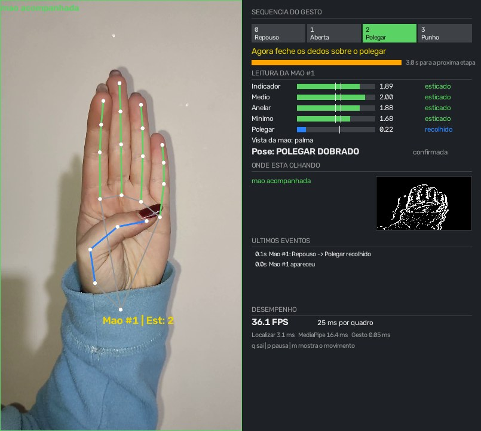
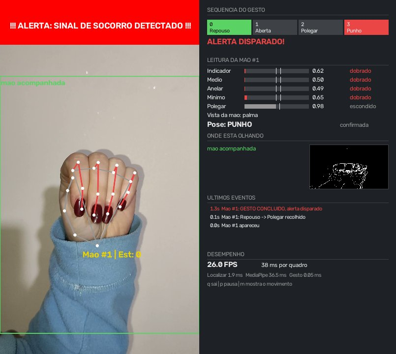
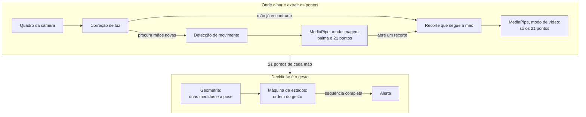
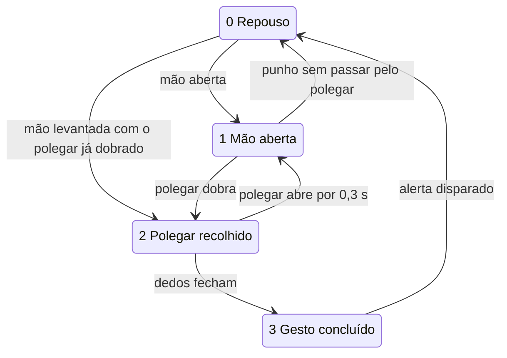

# Identificação contínua do Sinal de Pedido de Socorro

Sistema de visão computacional que acompanha o vídeo de uma câmera comum e avisa quando alguém faz o
**Sinal Universal de Pedido de Socorro** ([*Signal for Help*](https://en.wikipedia.org/wiki/Signal_for_Help)),
o gesto criado pela Canadian Women's Foundation para pedir ajuda sem falar nada.

Roda só na CPU, sem placa de vídeo e sem internet. Nenhuma imagem é gravada durante o monitoramento.

TCC de Arthur Romanatto Moro e Lucas Abati Zanotto, com orientação de Herculano Haymussi De Biasi (Unoesc, 2026).

| Durante o gesto | Gesto reconhecido |
|---|---|
|  |  |

<sub>Imagens do sistema rodando sobre o vídeo [Signal for Help (demonstrative example)](https://commons.wikimedia.org/wiki/File:Signal_for_Help(_demonstrative_example_).ogg), de GemoWiki, licença CC BY 4.0, com o painel acrescentado.</sub>

## O gesto

1. Mão aberta, com os dedos esticados.
2. O polegar dobra sobre a palma.
3. Os outros quatro dedos fecham por cima do polegar.

O que importa é a ordem. Quem fecha a mão normalmente dobra os dedos com o polegar ainda para fora, e nesse caso o sistema não dispara.

## Baixar e instalar

Você vai precisar de:

- [Python 3.12](https://www.python.org/downloads/release/python-31210/), a versão usada nos testes. As dependências pedem no mínimo a 3.11. No Windows, marque "Add python.exe to PATH" na instalação.
- Git, ou baixe o projeto pelo botão **Code > Download ZIP** aqui do GitHub.
- Uma webcam, um celular ou um vídeo gravado. Placa de vídeo não é necessária.

Baixe o projeto e crie um ambiente só para ele:

```bash
git clone https://github.com/LucasZanotto/identificacao-sinal-de-socorro.git
cd identificacao-sinal-de-socorro
python -m venv .venv
```

Ative o ambiente com o comando do seu terminal:

```bash
# Windows, PowerShell
.venv\Scripts\Activate.ps1

# Windows, Prompt de Comando
.venv\Scripts\activate.bat

# Linux e macOS
source .venv/bin/activate
```

Instale as bibliotecas:

```bash
pip install -r requirements.txt
```

O modelo do MediaPipe (`hand_landmarker.task`) já vem no repositório. O sistema só foi testado no Windows 11.

## Rodar

```bash
python detecao_socorro.py
```

Isso abre a câmera padrão e uma janela com o vídeo e o painel. Sobre o vídeo aparece só a mão, com o quadrado verde. Faça o gesto olhando o painel. Quando ele é reconhecido,
aparece uma faixa vermelha, toca um som e fica um registro em `alertas.csv`, com a data, a hora e a posição da mão.

Teclas: `q` sai, `p` pausa e `m` mostra ou esconde a imagem do movimento.

### Ver tudo o que o sistema examina

```bash
python detecao_socorro_profundo.py
```

É o mesmo programa, com as mesmas opções e o mesmo resultado. A diferença é o que aparece na tela: ele desenha também os quadrados laranja das regiões que se mexeram e o quadro inteiro quando ele é examinado, e lista essas regiões no painel. Serve para entender por que uma mão foi ou não encontrada.

### Outras fontes de vídeo

| Fonte | Comando |
|---|---|
| Outra câmera do computador | `python detecao_socorro.py --fonte 1` |
| Vídeo gravado | `python detecao_socorro.py --fonte video.mp4` |
| Celular com [DroidCam](https://www.droidcam.app/) | `python detecao_socorro.py --fonte http://IP_DO_CELULAR:4747/video` |
| Câmera de segurança IP | `python detecao_socorro.py --fonte rtsp://usuario:senha@IP_DA_CAMERA:554/stream1` |

Com celular e câmera IP, o sistema lê a imagem em paralelo e usa sempre o quadro mais recente, então o vídeo não acumula
atraso, e tenta conectar de novo se a conexão cair. `--sem-janela` e `--sem-som` desligam a tela e o som.
`--localizador inteiro` e `--localizador yolo` trocam a detecção de movimento por outra forma de procurar a mão, só para comparar.

### Ver funcionando sem câmera

O primeiro comando baixa um vídeo público do gesto para `testes/dados` e confere o sistema nele. O segundo mostra o vídeo com o painel. O alerta deve aparecer duas vezes, perto de 1,3 s e de 4,2 s.

```bash
python -m pytest testes/test_video_real.py
python detecao_socorro.py --fonte testes/dados/signal_for_help_wikimedia.ogg
```

### O que o painel mostra

- **No vídeo:** o quadrado verde da mão acompanhada e os pontos da mão. Dedo verde está esticado, vermelho está dobrado e amarelo está em dúvida. O polegar fica azul quando está recolhido.
- **Sequência do gesto:** em que etapa está, o que ele espera agora e quanto tempo falta para desistir.
- **Leitura da mão:** a medida de cada dedo e do polegar, com os limites que decidem a pose, e a pose que ele entendeu.
- **Onde está olhando:** se há mão acompanhada, com a imagem do que se mexeu. A versão profunda lista também as regiões em movimento.
- **Últimos eventos:** cada mudança de etapa, com o motivo quando a sequência volta ao início. O terminal mostra o mesmo.
- **Desempenho:** FPS e o tempo de cada parte.

## Como funciona

Cada quadro passa pelas etapas abaixo e depois é descartado.



**1. Correção de luz.** Se o brilho médio do quadro fica abaixo de 90, em uma escala de 0 a 255, a imagem é clareada com correção gama. Quadro claro passa direto.

**2. Onde procurar.** O detector de palma do MediaPipe reduz a imagem para 192x192 pixels, e nessa redução uma mão a 3 ou 4 metros praticamente some. Para contornar isso, o MOG2 do OpenCV compara cada quadro com um modelo do fundo da cena e aponta o que se mexeu. Recortar essa região funciona como um zoom. Essa etapa não usa rede neural. Quando nada se mexe, o MediaPipe olha o quadro inteiro a cada 5 quadros, o que cobre uma mão parada perto da câmera.

**3. Pontos da mão.** O MediaPipe Hand Landmarker devolve 21 pontos de cada mão encontrada: pulso, articulações e pontas dos dedos.

**4. Acompanhar a mão.** Cada mão encontrada ganha um recorte só dela, que a segue nos quadros seguintes, e o modo de vídeo do MediaPipe passa a acompanhá-la usando a posição anterior. O detector de palma deixa de ser necessário, e é ele que costuma perder a mão virada, fechada ou coberta. O sistema acompanha até 2 mãos por vez.

**5. Geometria.** Os pontos viram duas medidas. Como são razões entre distâncias, o valor não muda com a distância da câmera.

| Medida | Cálculo | Leitura |
|---|---|---|
| Abertura de cada dedo | distância da ponta ao pulso ÷ distância da base do dedo ao pulso | 1,5 ou mais é esticado, 1,4 ou menos é dobrado. Fica perto de 1,8 com o dedo esticado e de 0,9 com o dedo fechado |
| Polegar | distância da ponta do polegar à base do dedo mínimo ÷ largura da palma | Menos de 1,1 é recolhido |

Com isso cada quadro recebe uma pose: **aberta** (quatro dedos esticados e polegar para fora), **polegar** (quatro dedos esticados e polegar recolhido), **punho** (quatro dedos dobrados) ou nenhuma. A palma não precisa estar de frente, então as costas da mão também contam. No punho o polegar não é conferido, porque ele fica escondido e o modelo só estima a posição.

**6. Máquina de estados.** A pose de um quadro não diz nada sozinha. O que identifica o sinal é a sequência, conferida por uma máquina de estados para cada mão.



Três tempos protegem essa sequência:

| Parâmetro | Valor | Para que serve |
|---|---|---|
| `tempo_confirmacao` | 0,13 s | A pose precisa durar isso para valer, o que ignora leituras erradas em quadros borrados. É contado em tempo, então funciona igual em qualquer FPS |
| `tempo_cancelar` | 0,3 s | A mão aberta precisa durar isso para desfazer o polegar recolhido, porque a imagem borra enquanto os dedos fecham rápido |
| `timeout_estado` | 3 s | Sem ver a pose da etapa atual por esse tempo, a sequência volta ao início |

**7. Alerta.** Faixa vermelha na tela, som e uma linha em `alertas.csv`. O aviso fica só no computador de monitoramento, porque um alarme no próprio ambiente filmado poderia denunciar a vítima a quem está perto dela. Ele é um pedido de verificação para uma pessoa, não a confirmação de uma ocorrência.

### Sobre redes neurais

O trabalho não treina nenhuma rede neural, e a decisão do gesto é só geometria. Os dois modelos do MediaPipe, o detector de palma e o de pontos, são redes convolucionais pequenas usadas prontas, apenas para extrair os pontos. O YOLOv8n não faz parte do sistema: ele foi usado em um protótipo anterior e hoje serve só para comparar o gasto na avaliação.

## Gravar os vídeos de teste

Cada sessão grava 62 clipes de 6 segundos (33 com o sinal e 29 de controle), em cerca de 12 minutos. O programa diz o que fazer em cada clipe e já salva com o nome certo.

```bash
python gravar_dataset.py --pessoa P01 --fitzpatrick III --dataset C:\tcc\dataset
```

- `--pessoa` é um código, nunca o nome. Neste trabalho, P01 é a primeira sessão do participante e P01_s2 é a segunda. O sufixo `_s2` faz o relatório entender que é a mesma pessoa.
- `--fitzpatrick` é o tom de pele na escala de Fitzpatrick (I a VI). É obrigatório no comando e só serve para agrupar o relatório.
- Com o celular como câmera, acrescente `--fonte http://IP_DO_CELULAR:4747/video`.
- Grave fora de pastas sincronizadas, como OneDrive e Google Drive, para os vídeos não subirem para a nuvem.

`ESPAÇO` grava, `R` refaz o clipe anterior e `Q` sai. Se parar no meio, o mesmo comando continua de onde parou, e para refazer um clipe basta apagar o arquivo dele. Os cenários e as ações estão na lista `ROTEIRO` de `gravar_dataset.py`.

Vídeos gravados direto no celular também servem, nas mesmas pastas e com os mesmos nomes:

```
dataset/pessoas.csv                       (colunas: pessoa,fitzpatrick)
dataset/P01/plena/socorro_01.mp4
dataset/P01/plena/acenar_01.mp4
```

## Avaliar

```bash
python avaliar.py --dataset C:\tcc\dataset --calibrar P01 --distancia
```

- `--calibrar P01` usa os clipes dessa pessoa só para ajustar os limites, e eles ficam fora do teste. Sem essa opção, o relatório é só uma prévia.
- `--distancia` encolhe a imagem como se a pessoa estivesse mais longe, para descobrir até que tamanho de mão o sistema funciona. Essa parte demora, porque processa os vídeos de novo.
- Para a avaliação comparar o gasto com o YOLO, rode antes `pip install -r requirements-comparacao.txt`. Sem isso ela funciona e pula essa comparação.

Os pontos extraídos ficam em `dataset/_landmarks`, então rodar de novo é rápido. A saída fica em `resultados/`:

| Arquivo | Conteúdo |
|---|---|
| `relatorio.md` | Todas as tabelas: métricas com intervalo de confiança, cenários, comparações, estresse e erros |
| `por_clipe.csv` | O resultado de cada clipe |
| `custo_localizador.png` | Gasto da detecção de movimento e do YOLO |
| `matriz_confusao.png`, `metricas_por_cenario.png` | As outras figuras |

Antes de contar um alarme como erro, assista ao clipe. É fácil fazer o sinal sem querer em um clipe de controle.

## Testes automáticos

```bash
python -m pytest testes
```

Os testes da lógica usam uma mão sintética e não precisam de câmera. `test_video_real.py` baixa o vídeo público do gesto e roda o sistema inteiro nele. Esses testes conferem o programa, mas não medem a precisão em pessoas reais. Isso é papel do `avaliar.py`.

## Arquivos do projeto

| Arquivo | O que faz |
|---|---|
| `detecao_socorro.py` | Programa principal: lê o vídeo e liga todas as partes |
| `detecao_socorro_profundo.py` | O mesmo programa, mostrando também as regiões que se mexeram |
| `pipeline.py` | Correção de luz, detecção de movimento, MediaPipe e os recortes que seguem cada mão |
| `gesto.py` | Medidas geométricas, poses e máquina de estados. Não depende de câmera nem de modelo |
| `painel.py` | A tela que mostra o que o sistema está pensando |
| `alerta.py` | Faixa, som e registro em `alertas.csv` |
| `gravar_dataset.py` | Gravação guiada dos clipes |
| `avaliar.py` | Avaliação completa e relatório |
| `testes/` | Testes automáticos |
| `hand_landmarker.task` | Modelo pronto do MediaPipe |
| `yolov8n.pt` | Modelo pronto do YOLOv8n, só para a comparação de gasto |

## Resultados

> **Medição final com uma pessoa só**, um dos autores, que conhece o gesto. Os 58 clipes da primeira sessão serviram só para calibrar. Os 62 clipes da segunda sessão, gravados depois de o código e os limites estarem fechados, formam o teste. Os resultados não valem para outras pessoas nem para outros tons de pele.

O sistema reconheceu **33 de 33 sinais** e disparou em **1 de 29 clipes de controle**:

| Métrica | Valor | Intervalo de confiança de 95% |
|---|---|---|
| Acurácia | 98,4% | 91,4 a 99,7 |
| Precisão | 97,1% | 85,1 a 99,5 |
| Sensibilidade | 100,0% | 89,6 a 100,0 |
| Especificidade | 96,6% | 82,8 a 99,4 |
| F1-Score | 98,5% | 94,6 a 100,0 |

Todos os cenários tiveram todos os sinais reconhecidos, inclusive pouca luz, mão virada, costas da mão, manga de longe, câmera alta, longe, oclusão e movimento brusco. Cada cenário tem de 5 a 9 clipes, então isso mostra onde o sistema funciona, mas não é uma taxa precisa.

O único alarme falso foi em um clipe com pouca luz, em que a mão fecha com o polegar encostado no indicador. Assistindo ao clipe, o polegar fica por fora do punho, então o erro é do sistema: o polegar encostou na palma antes de os dedos fecharem e foi lido como recolhido.

**Comparação com regras mais simples, nos mesmos clipes:**

| Regra de decisão | Acurácia | Sensibilidade | Especificidade | McNemar p |
|---|---|---|---|---|
| Sistema proposto | 98,4% | 100,0% | 96,6% | referência |
| Protótipo anterior | 91,9% | 100,0% | 82,8% | 0,1250 |
| Abre e fecha, sem olhar o polegar | 74,2% | 100,0% | 44,8% | 0,0001 |
| Só punho, sem sequência | 62,9% | 100,0% | 20,7% | menor que 0,0001 |

**Onde o MediaPipe olha:** detecção de movimento e YOLO deram o mesmo resultado em todos os clipes. No quadro inteiro, a sensibilidade caiu para 87,9%, com 1 de 3 sinais de longe.

**Rastreamento:** sem ele, a sensibilidade caiu para 84,8%, com 1 de 3 sinais na mão virada, e o alarme falso não aparece. Cinco clipes só deram certo com o rastreamento e um só deu certo sem ele (McNemar p = 0,2188).

**Correção de luz:** os sinais foram reconhecidos com e sem ela, e o único alarme falso só acontece com ela ligada. Um clipe não prova que ela atrapalha, mas este teste também não mostrou ganho.

**Gasto**, sem placa de vídeo, em um Ryzen 5 4600G com 16 GB, com o vídeo chegando a 15 quadros por segundo. A CPU é o percentual do processador inteiro:

| Configuração | Tempo por quadro | FPS máximo | CPU | Memória |
|---|---|---|---|---|
| **Movimento + MediaPipe (o sistema)** | **24,7 ms** | **40,5** | **4,2%** | **313 MB** |
| O mesmo, sem o rastreamento | 31,9 ms | 31,4 | 5,1% | 304 MB |
| MediaPipe no quadro inteiro | 18,1 ms | 55,4 | 3,7% | 303 MB |
| YOLO a cada 3 quadros + MediaPipe | 41,6 ms | 24,0 | 9,8% | 641 MB |
| YOLO em todo quadro + MediaPipe | 88,4 ms | 11,3 | 19,7% | 636 MB |

Medidas geométricas e máquina de estados levam 0,042 ms por quadro.

**Distância simulada**, encolhendo a imagem dos mesmos clipes em cinco escalas, por isso os totais são maiores que o número de clipes. A palma mede cerca de 57 pixels a 1,5 m e cerca de 32 pixels a 3 ou 4 m. É aqui que a detecção de movimento faz diferença:

| Tamanho da palma | Sinais, com movimento | Alarmes, com movimento | Sinais, quadro inteiro | Alarmes, quadro inteiro |
|---|---|---|---|---|
| 60 pixels ou mais | 10 de 10 | 0 de 2 | 10 de 10 | 0 de 2 |
| 40 a 60 | 37 de 37 | 1 de 27 | 36 de 37 | 1 de 27 |
| 30 a 40 | 21 de 21 | 0 de 15 | 18 de 21 | 1 de 15 |
| 20 a 30 | 37 de 38 | 0 de 36 | 16 de 38 | 0 de 36 |
| 15 a 20 | 24 de 28 | 0 de 19 | 4 de 28 | 0 de 19 |
| 10 a 15 | 15 de 25 | 0 de 32 | 0 de 25 | 0 de 32 |
| menos de 10 | 1 de 6 | 1 de 14 | 0 de 6 | 0 de 14 |

## Limitações

- **Uma pessoa só.** Os testes usam um dos autores, que conhece o gesto e acompanhou o desenvolvimento, em duas sessões no mesmo dia. Os resultados não valem para outras pessoas nem para outros tons de pele.
- **Poucos clipes por cenário.** O cenário de oclusão, por exemplo, deu 100% de acurácia, mas o intervalo de confiança vai de 56,6 a 100.
- **Polegar encostado na palma:** uma mão que encosta o polegar na palma antes de fechar pode ser confundida com o sinal, porque no punho o polegar não é conferido.
- **Câmera real ainda não foi testada.** A câmera dos testes foi um celular com DroidCam, em um computador mais potente do que um dispositivo embarcado.
- **Clipes curtos:** a medição não diz quantos alarmes falsos apareceriam em horas de monitoramento.
- **Costas da mão:** o polegar fica escondido e o modelo só estima a posição dele.
- **Mão totalmente de lado:** os dedos se escondem uns atrás dos outros, então o gesto tende a falhar.
- **Câmera fixa:** a detecção de movimento pressupõe que a câmera não se mexe.
- **Só este gesto.** O sistema também não sabe se a pessoa está fazendo o gesto de brincadeira, por isso o alerta precisa de verificação humana.

## Problemas comuns

| O que aparece | O que fazer |
|---|---|
| `python` não é reconhecido | Instale o Python marcando "Add python.exe to PATH", ou use `py -3.12` no lugar de `python` |
| Erro de instalação em `matplotlib` ou outra biblioteca | Confira a versão com `python --version` e use a 3.12 |
| `Activate.ps1` bloqueado por "execução de scripts" | Rode `Set-ExecutionPolicy -Scope Process RemoteSigned`, que só vale para aquela janela, ou use o Prompt de Comando |
| `Não foi possível abrir a fonte de vídeo` | Outro programa pode estar usando a câmera. Feche-o ou tente `--fonte 1`. No celular, confira o IP e se os dois aparelhos estão na mesma rede |
| `No module named 'ultralytics'` | Só acontece com `--localizador yolo`. Rode `pip install -r requirements-comparacao.txt` |
| A mão não é encontrada de longe | Deixe a câmera parada e mexa a mão, porque é o movimento que indica onde procurar. Abaixo de uns 10 pixels de palma o reconhecimento cai bastante |
| O gesto não dispara | Olhe a **Leitura da mão** no painel: ela mostra qual dedo ficou fora do limite e em que etapa a sequência parou |

## Créditos

- [Signal for Help](https://en.wikipedia.org/wiki/Signal_for_Help): gesto criado pela Canadian Women's Foundation.
- [MediaPipe Hand Landmarker](https://ai.google.dev/edge/mediapipe/solutions/vision/hand_landmarker), do Google, licença Apache 2.0.
- [OpenCV](https://opencv.org/), licença Apache 2.0.
- [YOLOv8n](https://github.com/ultralytics/ultralytics), da Ultralytics, licença AGPL-3.0, usado só para comparar o gasto.
- Vídeo de teste de [GemoWiki](https://commons.wikimedia.org/wiki/File:Signal_for_Help(_demonstrative_example_).ogg), licença CC BY 4.0.

Projeto acadêmico. O código ainda não tem uma licença definida.
