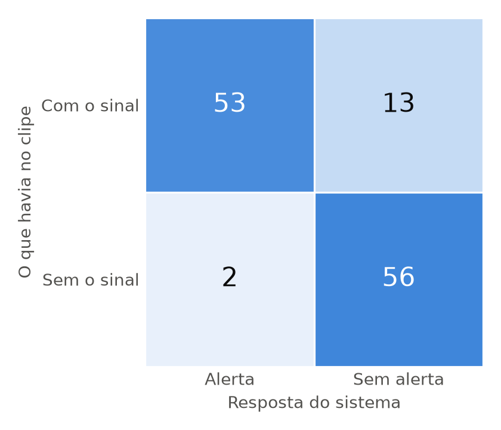
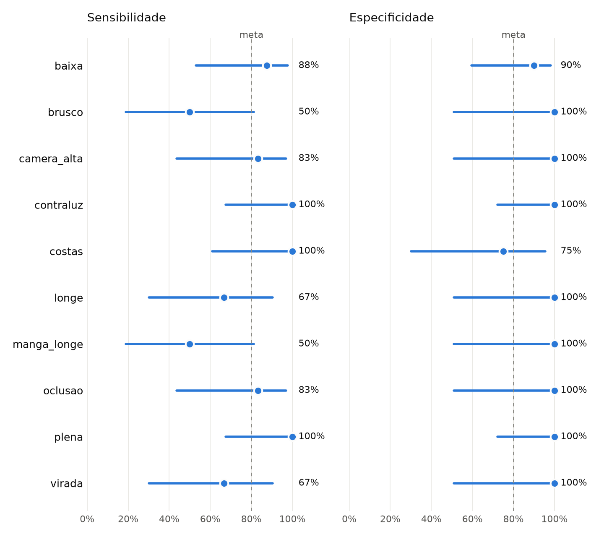
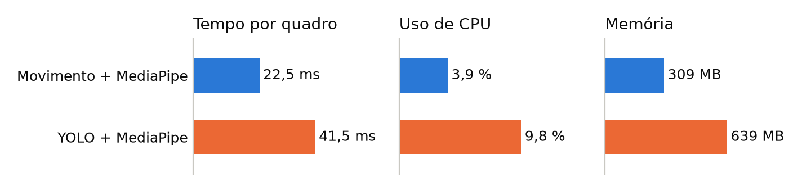

# Resultados da avaliação

Esta página reúne todos os números da medição final do TCC, inclusive os que ficaram de fora do texto por falta de espaço. Eles vêm do relatório gerado por `avaliar.py` em 07/11/2026.

> **Duas pessoas, os próprios autores**, com o mesmo tom de pele (III na escala de Fitzpatrick) e que já conheciam o gesto. Os 58 clipes da primeira sessão de um dos autores (P01) serviram só para calibrar os limites. O teste usa 124 clipes gravados depois de o código e os limites estarem fechados, 62 da segunda sessão do mesmo autor (P01_s2) e 62 do outro autor (P02). Os resultados não valem para outras pessoas nem para outros tons de pele.

## Base de vídeos

Cada sessão tem 62 clipes de 6 segundos, gravados com `gravar_dataset.py`, em 1280x720 pixels a cerca de 30 quadros por segundo. Os clipes são analisados a até 15 quadros por segundo.

| Cenário | Condição | Com o sinal | Controle |
|---|---|---|---|
| Plena | Luz artificial adequada, a cerca de 1,5 m da câmera | 4 | 5 |
| Baixa | Ambiente subexposto, a 1,5 m | 4 | 5 |
| Contraluz | Fonte de luz forte atrás da pessoa, a 1,5 m | 4 | 5 |
| Oclusão | Luz adequada, com copo ou manga cobrindo parte da mão | 3 | 2 |
| Brusco | Luz adequada, com a mão em movimento rápido | 3 | 2 |
| Longe | Luz adequada, a 3 ou 4 m da câmera | 3 | 2 |
| Virada | Luz adequada, a 1,5 m, com a palma virada cerca de 45 graus para o lado | 3 | 2 |
| Costas | Luz adequada, a 1,5 m, com as costas da mão para a câmera | 3 | 2 |
| Manga de longe | Luz adequada, a 3 ou 4 m, com a manga cobrindo parte da palma | 3 | 2 |
| Câmera alta | Luz adequada, com a câmera a cerca de 2,5 m de altura, inclinada para baixo | 3 | 2 |
| **Total** | | **33** | **29** |

Os controles são gestos comuns ou parecidos com o sinal: acenar, apontar, coçar a cabeça, abrir e fechar a mão com o polegar por fora, fechar a mão com o polegar encostado no indicador, segurar um copo, ajeitar a manga e mexer a mão rápido.

**Sessões.** P01 e P01_s2 foram gravadas em 02/11/2026, com cerca de três horas entre elas, e P02 em 04/11/2026. A primeira sessão tinha 62 clipes, mas 4 foram retirados antes da calibração porque foram gravados errado: em três controles o sinal foi feito de verdade, e em um clipe de sinal a mão já começava fechada. Nos clipes de teste nenhum clipe foi retirado.

**Tempo dos clipes.** Até 07/11/2026 o `gravar_dataset.py` media a câmera nos primeiros quadros, quando ela ainda está ajustando a imagem, e gravava o arquivo com uma taxa menor que a real: 26 quadros por segundo nos clipes de P01 e P01_s2 e 16 nos de P02, contra cerca de 30 reais. A avaliação corrige isso usando o número de quadros dividido pelos 6 segundos de cada clipe (`fps_do_video` em `avaliar.py`), e o gravador agora mede a câmera depois que ela estabiliza.

**Condições medidas nos clipes de teste.** As duas gravações foram bem diferentes, e isso aparece nos resultados.

| Cenário | Palma, P01_s2 (pixels) | Palma, P02 (pixels) |
|---|---|---|
| Plena | 57 | 59 |
| Baixa | 49 | 62 |
| Contraluz | 62 | 50 |
| Oclusão | 56 | 43 |
| Brusco | 56 | 51 |
| Longe | 32 | 24 |
| Virada | 62 | 43 |
| Costas | 62 | 45 |
| Manga de longe | 34 | 21 |
| Câmera alta | 44 | 22 |

O brilho médio dos quadros, de 0 a 255, ficou perto de 55 no cenário de pouca luz de P01_s2 e perto de 14 no de P02, que é quase escuro. Nos outros cenários ficou entre 93 e 192.

## Configuração e ambiente

A calibração procura, um parâmetro por vez, o valor com maior F1-Score e só troca o valor de partida quando há ganho. Nos 58 clipes da primeira sessão ela não mudou nenhum limite:

| Parâmetro | Valor | O que faz |
|---|---|---|
| `dedo_estendido` | 1,5 | Abertura a partir da qual o dedo conta como esticado |
| `dedo_dobrado` | 1,4 | Abertura abaixo da qual o dedo conta como dobrado |
| `limiar_polegar` | 1,1 | Abaixo disso o polegar está recolhido |
| `exigir_palma` | não | A palma não precisa estar de frente para a câmera |
| `tempo_confirmacao` | 0,13 s | Quanto uma pose precisa durar para valer |
| `tempo_cancelar` | 0,3 s | Quanto a mão aberta precisa durar para desfazer o polegar recolhido |
| `timeout_estado` | 3 s | Sem a pose da etapa atual por esse tempo, a sequência recomeça |
| `tempo_perda` | 1 s | Depois disso uma mão que sumiu é descartada |
| `fator_rastreio` | 1,5 | Distância do pulso, em tamanhos de palma, para ligar a mão de um quadro ao seguinte |

Ambiente: Windows 11, AMD Ryzen 5 4600G (6 núcleos, 12 threads), 16 GB de RAM, sem placa de vídeo, Python 3.12.10, opencv-python 5.0.0.93, mediapipe 1.2.0, ultralytics 8.4.198 e torch 2.15.0.

## Reconhecimento

Cada clipe conta uma vez: um alerta em qualquer momento é resposta positiva. O intervalo é de 95%, pelo método de Wilson, e o do F1-Score vem de 2.000 reamostragens dos clipes.



| Métrica | Valor | Intervalo de confiança de 95% |
|---|---|---|
| Acurácia | 87,9% | 81,0 a 92,5 |
| Precisão | 96,4% | 87,7 a 99,0 |
| Sensibilidade | 80,3% | 69,2 a 88,1 |
| Especificidade | 96,6% | 88,3 a 99,0 |
| F1-Score | 87,6% | 80,7 a 93,3 |

**Por pessoa:**

| Sessão de teste | Clipes | VP | FN | VN | FP | Acurácia (IC 95%) | Sensibilidade (IC 95%) | Especificidade (IC 95%) |
|---|---|---|---|---|---|---|---|---|
| P01_s2 | 62 | 33 | 0 | 28 | 1 | 98,4% (91,4 a 99,7) | 100,0% (89,6 a 100,0) | 96,6% (82,8 a 99,4) |
| P02 | 62 | 20 | 13 | 28 | 1 | 77,4% (65,6 a 86,0) | 60,6% (43,7 a 75,3) | 96,6% (82,8 a 99,4) |

**Por cenário**, somando as duas pessoas:

| Cenário | Clipes | VP | FN | VN | FP | Acurácia (IC 95%) | Sensibilidade (IC 95%) | Especificidade (IC 95%) |
|---|---|---|---|---|---|---|---|---|
| Baixa | 18 | 7 | 1 | 9 | 1 | 88,9% (67,2 a 96,9) | 87,5% (52,9 a 97,8) | 90,0% (59,6 a 98,2) |
| Brusco | 10 | 3 | 3 | 4 | 0 | 70,0% (39,7 a 89,2) | 50,0% (18,8 a 81,2) | 100,0% (51,0 a 100,0) |
| Câmera alta | 10 | 5 | 1 | 4 | 0 | 90,0% (59,6 a 98,2) | 83,3% (43,6 a 97,0) | 100,0% (51,0 a 100,0) |
| Contraluz | 18 | 8 | 0 | 10 | 0 | 100,0% (82,4 a 100,0) | 100,0% (67,6 a 100,0) | 100,0% (72,2 a 100,0) |
| Costas | 10 | 6 | 0 | 3 | 1 | 90,0% (59,6 a 98,2) | 100,0% (61,0 a 100,0) | 75,0% (30,1 a 95,4) |
| Longe | 10 | 4 | 2 | 4 | 0 | 80,0% (49,0 a 94,3) | 66,7% (30,0 a 90,3) | 100,0% (51,0 a 100,0) |
| Manga de longe | 10 | 3 | 3 | 4 | 0 | 70,0% (39,7 a 89,2) | 50,0% (18,8 a 81,2) | 100,0% (51,0 a 100,0) |
| Oclusão | 10 | 5 | 1 | 4 | 0 | 90,0% (59,6 a 98,2) | 83,3% (43,6 a 97,0) | 100,0% (51,0 a 100,0) |
| Plena | 18 | 8 | 0 | 10 | 0 | 100,0% (82,4 a 100,0) | 100,0% (67,6 a 100,0) | 100,0% (72,2 a 100,0) |
| Virada | 10 | 4 | 2 | 4 | 0 | 80,0% (49,0 a 94,3) | 66,7% (30,0 a 90,3) | 100,0% (51,0 a 100,0) |



Com 10 a 18 clipes por cenário, os intervalos são largos. Esses números mostram onde o sistema funciona e onde falha, mas não são taxas precisas.

**Tempo.** Nos clipes com o sinal, o alerta saiu em média 2,75 s depois do início do clipe. Esse tempo inclui a demora da própria pessoa para começar e completar o gesto. Depois que a mão fecha, basta o punho durar 0,13 s, mais o tempo de processar o quadro.

## Erros

Todos os clipes com erro foram conferidos quadro a quadro. Nenhum foi retirado nem teve o rótulo trocado.

**Sinais perdidos (13, todos de P02).** Em todos o gesto foi feito. Pelo ponto em que a sequência parou, em 6 o sistema viu a mão aberta mas não o polegar dobrado, em 4 a mão quase não foi detectada e em 3 ele viu o polegar dobrado mas não o punho.

| Clipe | O que os quadros mostram |
|---|---|
| `baixa/socorro_02` | Cena quase escura (brilho perto de 14). A mão não foi detectada em nenhum quadro |
| `brusco/socorro_01`, `_02`, `_03` | Braço em movimento amplo e rápido. A mão borra e some na maior parte dos quadros |
| `camera_alta/socorro_03` | Mão pequena na imagem (palma perto de 22 pixels) |
| `longe/socorro_01`, `_03` | Mão pequena (palma perto de 24 pixels). O sistema viu a mão aberta, mas não o polegar |
| `manga_longe/socorro_01`, `_02`, `_03` | Mão pequena (palma perto de 21 pixels) e coberta pela manga, com o braço esticado para o lado |
| `oclusao/socorro_03` | O polegar foi reconhecido, mas o punho ficou escondido pela manga |
| `virada/socorro_01`, `_03` | A mão girou mais que os 45 graus do roteiro e ficou de lado. Os dedos se escondem uns atrás dos outros e o punho não foi reconhecido |

**Alarmes falsos (2).**

| Clipe | O que os quadros mostram |
|---|---|
| `P01_s2/baixa/fechar_colado_01` | Pouca luz. O polegar encostou na palma antes de a mão fechar e foi lido como recolhido. Ele fica por fora do punho, então o erro é do sistema |
| `P02/costas/abrir_fechar_01` | Costas da mão para a câmera. O polegar fica escondido e o modelo só estima a posição dele, que foi lida como recolhida |

Como no punho o polegar não é conferido, uma mão que fecha com o polegar escondido completa a sequência. Por isso o alerta precisa de verificação humana.

## Comparações

Mesmos clipes e mesmos pontos, trocando uma parte de cada vez. O p vem do teste de McNemar exato contra o sistema proposto.

**Regra de decisão:**

| Regra | Acurácia (IC 95%) | Sensibilidade | Especificidade | F1-Score | McNemar p |
|---|---|---|---|---|---|
| Sistema proposto | 87,9% (81,0 a 92,5) | 80,3% | 96,6% | 87,6% | referência |
| Segundo protótipo | 87,9% (81,0 a 92,5) | 84,8% | 91,4% | 88,2% | 1,0000 (só o proposto acerta 4, só o outro acerta 4) |
| Abre e fecha, sem olhar o polegar | 71,0% (62,4 a 78,2) | 84,8% | 55,2% | 75,7% | menor que 0,0001 (24 a 3) |
| Só punho, sem sequência | 61,3% (52,5 a 69,4) | 89,4% | 29,3% | 71,1% | menor que 0,0001 (39 a 6) |

As regras mais simples reconhecem mais sinais, mas disparam muito mais à toa: 26 e 41 alarmes falsos em 58 controles, contra 2 do sistema proposto. O segundo protótipo empata em acurácia, trocando sinais reconhecidos por alarmes falsos.

**Onde o MediaPipe olha** (mesma regra de decisão). O YOLO reconheceu 5 sinais a mais que a detecção de movimento, todos em clipes com a mão pequena, e nenhum a menos (McNemar p = 0,0625):

| Cenário | Sens. movimento | Espec. movimento | Sens. quadro inteiro | Espec. quadro inteiro | Sens. YOLO | Espec. YOLO |
|---|---|---|---|---|---|---|
| Baixa | 87,5% | 90,0% | 75,0% | 90,0% | 87,5% | 90,0% |
| Brusco | 50,0% | 100,0% | 50,0% | 100,0% | 50,0% | 100,0% |
| Câmera alta | 83,3% | 100,0% | 100,0% | 100,0% | 83,3% | 100,0% |
| Contraluz | 100,0% | 100,0% | 100,0% | 100,0% | 100,0% | 100,0% |
| Costas | 100,0% | 75,0% | 100,0% | 75,0% | 100,0% | 75,0% |
| Longe | 66,7% | 100,0% | 33,3% | 100,0% | 100,0% | 100,0% |
| Manga de longe | 50,0% | 100,0% | 33,3% | 100,0% | 50,0% | 100,0% |
| Oclusão | 83,3% | 100,0% | 100,0% | 100,0% | 100,0% | 100,0% |
| Plena | 100,0% | 100,0% | 100,0% | 100,0% | 100,0% | 100,0% |
| Virada | 66,7% | 100,0% | 66,7% | 100,0% | 100,0% | 100,0% |
| **Todos** | **80,3%** | **96,6%** | **77,3%** | **96,6%** | **87,9%** | **96,6%** |

**Com e sem o rastreamento do MediaPipe.** Oito clipes só deram certo com o rastreamento e um só deu certo sem ele (McNemar p = 0,0391):

| Cenário | Sens. com rastreamento | Sens. sem rastreamento | Espec. com rastreamento | Espec. sem rastreamento |
|---|---|---|---|---|
| Baixa | 87,5% | 75,0% | 90,0% | 100,0% |
| Brusco | 50,0% | 50,0% | 100,0% | 100,0% |
| Câmera alta | 83,3% | 66,7% | 100,0% | 100,0% |
| Contraluz | 100,0% | 87,5% | 100,0% | 100,0% |
| Costas | 100,0% | 100,0% | 75,0% | 75,0% |
| Longe | 66,7% | 33,3% | 100,0% | 100,0% |
| Manga de longe | 50,0% | 50,0% | 100,0% | 100,0% |
| Oclusão | 83,3% | 83,3% | 100,0% | 100,0% |
| Plena | 100,0% | 100,0% | 100,0% | 90,0% |
| Virada | 66,7% | 33,3% | 100,0% | 100,0% |
| **Todos** | **80,3%** | **69,7%** | **96,6%** | **96,6%** |

**Com e sem a correção de luz**, nos cenários de luz difícil. Na cena quase escura de P02 ela fez diferença nos sinais, e o único alarme falso com pouca luz só acontece com ela ligada:

| Cenário | Sens. com correção | Sens. sem correção | Espec. com correção | Espec. sem correção |
|---|---|---|---|---|
| Baixa | 87,5% | 62,5% | 90,0% | 100,0% |
| Contraluz | 100,0% | 100,0% | 100,0% | 100,0% |

**Trabalhos relacionados.** Valores publicados pelos autores, com outros dados e outro hardware. Servem de referência, não de disputa direta:

| Trabalho | Abordagem | Resultado publicado | Velocidade publicada |
|---|---|---|---|
| Azimi et al. (2023) | CNN 3D (MobileNet) sobre o vídeo | 91,25% de acurácia | 16 FPS (i9 e RTX 2080 Ti), 6 FPS (Jetson Nano) |
| Buccellato et al. (2025) | MediaPipe, DeepSORT e Random Forest | 94% de acurácia | 0,067 s (Apple M3), 0,471 s (Jetson Orin Nano) |
| Shaik, Reddy e Shaik (2025) | MediaPipe, sequência aberta, punho, aberta | 84,2% ± 2,8% de acurácia | 6 a 10 FPS em notebook |
| Este trabalho | Movimento, MediaPipe, geometria e máquina de estados | 87,9% de acurácia, duas pessoas | 44,5 FPS máximo (Ryzen 5 4600G, sem placa de vídeo) |

## Custo computacional

Medido sem placa de vídeo, com o vídeo chegando a 15 quadros por segundo, cada configuração em um processo separado. O FPS máximo é o limite calculado pelo tempo médio de cada quadro. A CPU é o percentual do processador inteiro.

| Configuração | Tempo por quadro (ms) | p95 (ms) | Localizar (ms) | MediaPipe (ms) | Geometria e MEF (ms) | FPS máximo | CPU | RAM (MB) |
|---|---|---|---|---|---|---|---|---|
| **Movimento + MediaPipe (o sistema)** | **22,5** | **44,5** | **2,0** | **20,4** | **0,049** | **44,5** | **3,9%** | **309** |
| YOLO a cada 3 quadros + MediaPipe | 41,5 | 100,2 | 19,2 | 22,2 | 0,053 | 24,1 | 9,8% | 639 |
| YOLO em todo quadro + MediaPipe | 83,4 | 98,5 | 52,1 | 31,3 | 0,050 | 12,0 | 19,8% | 636 |
| Movimento + MediaPipe, sem rastreamento | 30,9 | 51,3 | 1,9 | 28,9 | 0,045 | 32,4 | 4,9% | 305 |
| MediaPipe no quadro inteiro | 17,2 | 41,7 | 0,2 | 16,9 | 0,045 | 58,2 | 3,5% | 303 |
| Sistema, imagem reduzida para 360 linhas | 21,3 | 39,9 | 1,7 | 19,0 | 0,049 | 46,9 | 3,8% | 304 |
| Sistema, mosaico com 2 cópias da cena | 26,1 | 45,7 | 1,8 | 22,6 | 0,078 | 38,3 | 4,5% | 316 |
| Sistema, mosaico com 4 cópias da cena | 29,4 | 49,1 | 1,9 | 22,4 | 0,079 | 34,0 | 4,8% | 327 |



O MediaPipe no quadro inteiro é o mais barato, mas perde mãos pequenas (veja a distância simulada). O mosaico custa pouco a mais em parte porque o sistema analisa no máximo dois recortes por quadro, o que também quer dizer que, em uma cena cheia, nem toda pessoa é analisada ao mesmo tempo.

## Estresse

**Mudança de configurações.** Cada linha muda um único parâmetro a partir da configuração usada. Nenhum valor foi trocado depois do teste, porque isso seria escolher o valor olhando o próprio resultado.

| Parâmetro | Valor | Acurácia | Sensibilidade | Especificidade |
|---|---|---|---|---|
| `limiar_polegar` | 0,8 | 83,9% | 71,2% | 98,3% |
| `limiar_polegar` | 0,9 | 87,1% | 77,3% | 98,3% |
| `limiar_polegar` | 1,0 | 87,9% | 78,8% | 98,3% |
| `limiar_polegar` | 1,1 (usado) | 87,9% | 80,3% | 96,6% |
| `limiar_polegar` | 1,2 | 87,9% | 81,8% | 94,8% |
| `limiar_polegar` | 1,3 | 87,9% | 81,8% | 94,8% |
| `dedo_estendido` | 1,4 | 88,7% | 81,8% | 96,6% |
| `dedo_estendido` | 1,5 (usado) | 87,9% | 80,3% | 96,6% |
| `dedo_estendido` | 1,6 | 87,1% | 78,8% | 96,6% |
| `dedo_estendido` | 1,7 | 80,6% | 65,2% | 98,3% |
| `dedo_dobrado` | 1,2 | 87,1% | 78,8% | 96,6% |
| `dedo_dobrado` | 1,3 | 87,9% | 80,3% | 96,6% |
| `dedo_dobrado` | 1,35 | 87,9% | 80,3% | 96,6% |
| `dedo_dobrado` | 1,4 (usado) | 87,9% | 80,3% | 96,6% |
| `timeout_estado` | 2,0 | 87,9% | 80,3% | 96,6% |
| `timeout_estado` | 3,0 (usado) | 87,9% | 80,3% | 96,6% |
| `timeout_estado` | 4,0 | 87,9% | 80,3% | 96,6% |
| `timeout_estado` | 5,0 | 87,9% | 80,3% | 96,6% |
| `tempo_confirmacao` | 0,0 | 82,3% | 86,4% | 77,6% |
| `tempo_confirmacao` | 0,07 | 87,9% | 80,3% | 96,6% |
| `tempo_confirmacao` | 0,13 (usado) | 87,9% | 80,3% | 96,6% |
| `tempo_confirmacao` | 0,2 | 87,1% | 77,3% | 98,3% |
| `tempo_confirmacao` | 0,27 | 86,3% | 75,8% | 98,3% |
| `tempo_cancelar` | 0,0 | 87,9% | 80,3% | 96,6% |
| `tempo_cancelar` | 0,15 | 87,9% | 80,3% | 96,6% |
| `tempo_cancelar` | 0,25 | 87,9% | 80,3% | 96,6% |
| `tempo_cancelar` | 0,3 (usado) | 87,9% | 80,3% | 96,6% |
| `tempo_cancelar` | 0,35 | 88,7% | 81,8% | 96,6% |
| `tempo_cancelar` | 0,5 | 88,7% | 81,8% | 96,6% |
| `exigir_palma` | sim | 83,1% | 69,7% | 98,3% |
| `exigir_palma` | não (usado) | 87,9% | 80,3% | 96,6% |
| Quadros por segundo analisados | cerca de 15 (usado) | 87,9% | 80,3% | 96,6% |
| Quadros por segundo analisados | cerca de 7 | 88,7% | 80,3% | 98,3% |
| Quadros por segundo analisados | cerca de 5 | 86,3% | 75,8% | 98,3% |

**Distância simulada.** A imagem de cada clipe de teste é encolhida dentro do mesmo quadro em cinco escalas (100%, 75%, 50%, 35% e 25%), como se a pessoa estivesse mais longe, e o resultado é agrupado pelo tamanho da palma em pixels. Por isso os totais passam do número de clipes. No quadro inteiro, o MediaPipe procura a mão sem a ajuda da detecção de movimento.

| Palma (pixels) | Sinais, movimento | Alarmes, movimento | Sinais, quadro inteiro | Alarmes, quadro inteiro |
|---|---|---|---|---|
| 60 ou mais | 14 de 14 | 0 de 8 | 14 de 14 | 0 de 8 |
| 40 a 60 | 57 de 63 | 1 de 53 | 54 de 63 | 1 de 53 |
| 30 a 40 | 35 de 40 | 1 de 34 | 32 de 40 | 2 de 34 |
| 20 a 30 | 52 de 70 | 2 de 68 | 21 de 70 | 2 de 68 |
| 15 a 20 | 32 de 56 | 1 de 44 | 4 de 56 | 1 de 44 |
| 10 a 15 | 21 de 55 | 1 de 57 | 1 de 55 | 0 de 57 |
| menos de 10 | 3 de 27 | 2 de 26 | 0 de 27 | 0 de 26 |

Com a palma a partir de 30 pixels, o sistema reconheceu 106 de 117 sinais. Entre 20 e 30 pixels caiu para 52 de 70, o que bate com os sinais perdidos nos clipes em que a mão aparecia pequena. Reduzir a imagem não reproduz o ruído e o borrão de uma mão que está de fato longe, então esses valores servem como orientação para escolher a câmera e a lente.

## Resultado de cada clipe

[`por_clipe.csv`](por_clipe.csv) tem uma linha por clipe de teste: se havia o sinal (`com_sinal`), se o alerta saiu (`alerta`), em que segundo (`t_alerta`), até que etapa a sequência chegou (`estado_maximo`) e em que fração dos quadros a mão foi encontrada (`frac_quadros_com_mao`). Os vídeos não são publicados.

## Como repetir a medição

Grave as sessões e rode a avaliação, como explicado no [README](../README.md#avaliar):

```bash
python avaliar.py --dataset C:\tcc\dataset --calibrar P01 --distancia
```
